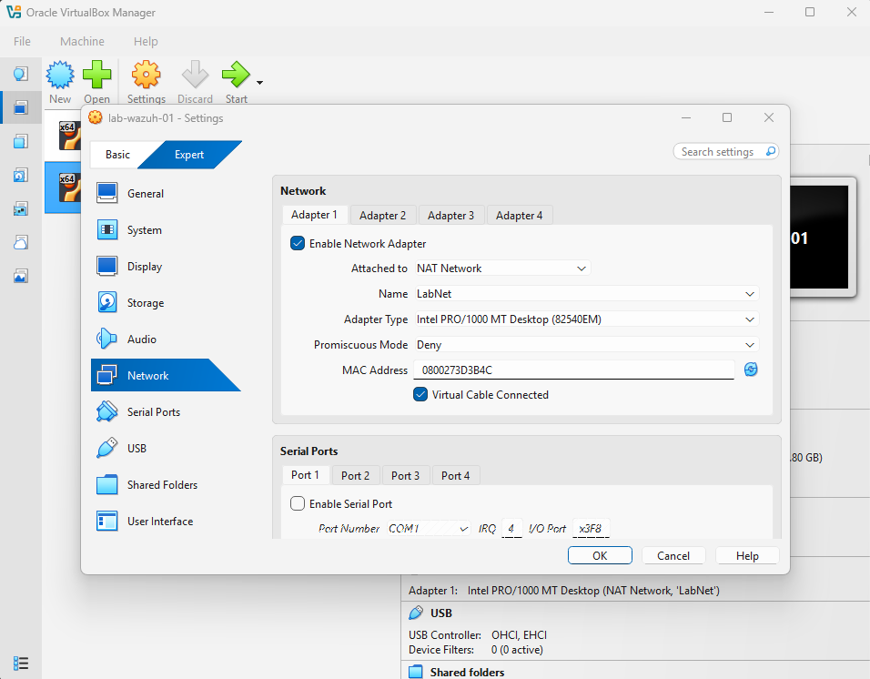
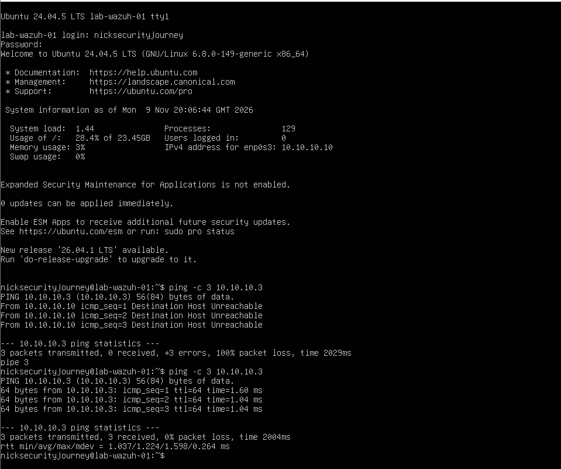
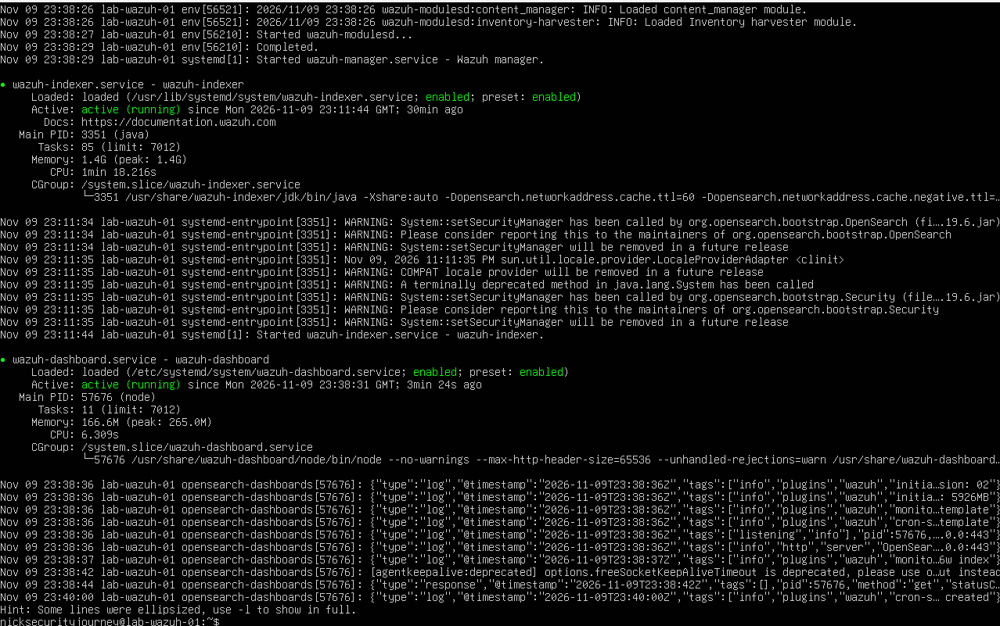
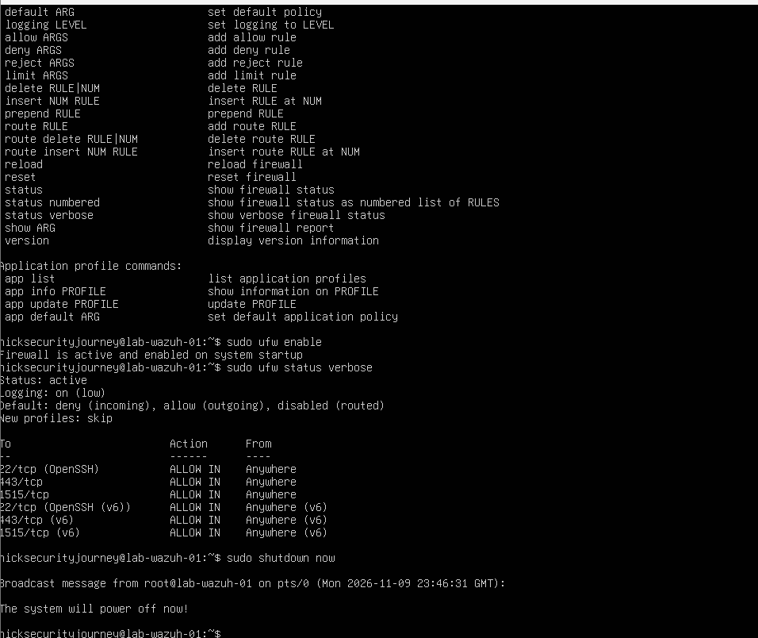

# Session 02: Git setup and building the Wazuh server

**Date:** 2026-11-09  |  **Phase:** 2 – Monitoring  |  **Time spent:** One evening, roughly 16:00–23:55 including breaks

## Goal

Set up git so this repo is managed from the command line under my NicksJourneyToSecurity account, then build a Wazuh server (SIEM) on the lab network and reach its dashboard from my PC. Connecting an agent and testing alerts is the next session.

## Setup

| Item | Detail |
| --- | --- |
| Repo | `F:\home-lab`, cloned from GitHub, committing as NicksJourneyToSecurity with the account's private noreply email |
| New VM | `lab-wazuh-01`: Ubuntu Server 24.04.5 LTS, 4 vCPU, 6GB RAM, 50GB VDI disk (dynamically sized) |
| Network | NAT Network `LabNet`, static IP `10.10.10.10`, gateway `10.10.10.1` |
| SIEM | Wazuh 4.14.10, all-in-one install (manager, indexer, dashboard) |
| Dashboard access | LabNet port forward from `127.0.0.1:8443` on my PC to `10.10.10.10:443` |

I used Ubuntu 24.04 for the Wazuh server rather than 26.04 because Wazuh 4.14 doesn't officially support 26.04 yet. `lab-ubuntu-01` stays on 26.04, so the lab now runs two Ubuntu versions side by side, as real environments often do.

## Steps

### Part A: Git for a second GitHub account

1. **Cloned the repo** to my F: drive, with the account name in the link so git would ask for that account's login rather than my other GitHub account's:

   ```bat
   F:
   cd \
   git clone https://NicksJourneyToSecurity@github.com/NicksJourneyToSecurity/home-lab.git
   cd home-lab
   ```

2. **Set the commit identity for this repo only** (no `--global`, so my other projects are unaffected), using GitHub's private noreply email so my real email isn't public:

   ```bat
   git config user.name "NicksJourneyToSecurity"
   git config user.email "<id>+NicksJourneyToSecurity@users.noreply.github.com"
   ```

3. **Fixed the repo structure** (see Problems & fixes), updated the README to mark phase 2 as in progress, then committed and pushed. Signed in as NicksJourneyToSecurity when prompted.

   ```bat
   git mv home-lab/README.md README.md
   git mv home-lab/phase-01-foundation phase-01-foundation
   git add -A
   git commit -m "fix folder structure and start phase 2"
   git push
   ```

4. **Checked the commit was credited correctly:**

   ```bat
   git log -1 --format="%an <%ae>"
   ```

   Result: `NicksJourneyToSecurity` with the noreply address.

### Part B: Building the Wazuh server

5. **Downloaded Ubuntu Server 24.04 and verified it** against the official SHA256SUMS file. The hash matched.
6. **Created the VM** `lab-wazuh-01` while the ISO was downloading: VDI disk format, 50GB, Pre-allocate Full Size unticked, Adapter 1 on `LabNet`. Attached the ISO once the download finished.

   

7. **Installed Ubuntu Server with a static IP.** On the installer's Network screen I changed IPv4 from automatic (DHCP) to Manual:

   | Setting | Value |
   | --- | --- |
   | Subnet | `10.10.10.0/24` |
   | Address | `10.10.10.10` |
   | Gateway | `10.10.10.1` |
   | Name servers | `1.1.1.1,8.8.8.8` |

   A fixed address means the agent and the port forward will always find the server.

8. **Updated, set the timezone and checked connectivity.** The login screen confirmed `10.10.10.10` on `enp0s3` and 0 updates waiting. With `lab-ubuntu-01` running, the Wazuh server could reach it:

   ```bash
   ping -c 3 10.10.10.3
   ```

   

9. **Took a snapshot** `01-clean-base` before installing Wazuh.
10. **Installed Wazuh** with the official all-in-one script. This took three attempts (see Problems & fixes); the successful run installed Wazuh 4.14.10.

    ```bash
    curl -O https://packages.wazuh.com/4.14/wazuh-install.sh
    sudo bash ./wazuh-install.sh -a
    ```

    The admin password the script printed was saved to a password manager and is not stored anywhere in this repo.

11. **Confirmed all three Wazuh components were running:**

    ```bash
    sudo systemctl status wazuh-manager wazuh-indexer wazuh-dashboard --no-pager
    ```

    Manager, indexer and dashboard all showed `active (running)`. The indexer was using about 1.4GB of RAM.

    

12. **Enabled the firewall**, with incoming traffic denied by default and rules allowing SSH (22), the dashboard (443) and agent registration (1515).

    ```bash
    sudo ufw allow OpenSSH
    sudo ufw allow 443/tcp
    sudo ufw allow 1515/tcp
    sudo ufw enable
    sudo ufw status verbose
    ```

    

13. **Shut down and took a snapshot** `02-wazuh-installed`.

### Part C: Reaching the dashboard

14. **Added a port forward rule to LabNet**, so the dashboard is reachable from my PC only:

    | Name | Protocol | Host IP | Host Port | Guest IP | Guest Port |
    | --- | --- | --- | --- | --- | --- |
    | wazuh-dashboard | TCP | 127.0.0.1 | 8443 | 10.10.10.10 | 443 |

    Because the rule listens on `127.0.0.1`, nothing else on my home network can use it.

15. **Logged in to the Wazuh dashboard** at `https://localhost:8443` as `admin`.

> **Update (session 03):** When I came back the next day, the dashboard was unreachable and the LabNet configuration had no port forward rules at all, so this rule hadn't been saved. I re-added it from PowerShell with `VBoxManage` and checked it was listed. See [session 03](2026-11-10-session-03.md).

## Problems & fixes

| Problem | Cause | Fix |
| --- | --- | --- |
| `'https:' is not recognized as an internal or external command` | I ran the repo link on its own, without `git clone` in front | Ran the full `git clone <link>` command |
| `git add README.md` failed with "pathspec did not match any files", and `git status` showed `home-lab/README.md` | During the phase 1 browser upload I dragged in the outer `home-lab` folder, so everything sat in `home-lab/home-lab/` and the repo front page showed no README | Moved both items up a level with `git mv` so git tracked them as renames, then committed and pushed |
| Downloaded a small text file instead of the installer | I'd downloaded `SHA256SUMS` (the list of official hashes), not the ISO | Downloaded the `live-server-amd64.iso` file as well; the text file is what I compare the ISO's hash against |
| Installer only offered DHCPv4 on the Network screen | DHCP is just the default; the manual option is one menu deeper | Selected the network card, chose Edit IPv4, then changed the method to Manual |
| Name servers rejected: "1.1.1.1.8.8.8.8 doesn't appear to be an IPv4 or IPv6 address" | I typed a dot instead of a comma between the two addresses | Entered `1.1.1.1,8.8.8.8` |
| "Failed unmounting cdrom.mount" after the install rebooted | The installer finishing with the virtual CD still attached; harmless | Pressed Enter to continue booting |
| First ping to `10.10.10.3` returned "Destination Host Unreachable" | `lab-ubuntu-01` was switched off | Started `lab-ubuntu-01` and pinged again; all 3 replies came back |
| `./wazuh-install.sh: No such file or directory` | The script never downloaded, and `curl -s` (silent) hid the error | Ran curl without `-s` to see what was happening |
| `curl: (2) no URL specified` (happened twice) | I used lowercase `-o` (save as a given filename), so curl treated the link as a filename | Used capital `-O` (save with the file's own name) |
| First Wazuh install failed: manager wouldn't start and the indexer and dashboard "could not be found" | The script removes what it installed when it fails, so the real error was earlier in the log | Searched the log for errors (see next row) |
| Finding the real error took a few attempts | The end of the log only showed the cleanup, and I mistyped `free -h` as `free 0h` and left `head` out of a piped command | `sudo grep -iE "error\|fail" /var/log/wazuh-install.log \| head -n 20` showed **"No space left on device"** |
| Disk full on a 50GB disk | Ubuntu's default disk layout (LVM) only gave the main partition about 24GB (the login screen showed 23.45GB) and left the rest unallocated | Extended the partition into the free space (see the last row) |
| Re-running the install with `-o` (overwrite) still failed: "The Wazuh manager package could not be removed" and `wazuh-keystore: No such file or directory` | The disk-full failure had left the manager package half-installed and broken, so the installer couldn't remove it or reinstall cleanly | Restored the `01-clean-base` snapshot to get a clean system back |
| Disk extension didn't work at first: "Invalid path", then "changed from 24.00 GiB to 24.00 GiB", then `df` still showing 24G | I typed `ubuntu/vg` instead of `ubuntu-vg`, then left the `+` out of `+100%FREE` (without it, the command sets the size rather than adding to it), then didn't run the second command | Ran both commands correctly; `df -h /` then showed about 47G |

The commands that extended the disk:

```bash
sudo lvextend -l +100%FREE /dev/ubuntu-vg/ubuntu-lv
sudo resize2fs /dev/mapper/ubuntu--vg-ubuntu--lv
df -h /
```

## What I learned

- Snapshots proved their worth: when the first install left a broken package behind, restoring `01-clean-base` got me back to a clean system in minutes instead of rebuilding the VM.
- When an install fails, the last lines of a log may only show the cleanup. Searching the whole log for "error" or "fail" found the real cause.
- One problem can cause another: the full disk broke a package, and that broken package is what made the second attempt fail.
- Ubuntu Server doesn't use the whole disk by default, so I need to check `df -h /` on new servers that need a lot of space.
- Small details matter in commands: `-o` vs `-O`, a dot vs a comma, `ubuntu/vg` vs `ubuntu-vg`, and a missing `+` all gave completely different results.
- Git can use a different account and identity for one repo without affecting my others, and `git mv` lets me reorganise files while keeping their history.

## Next steps

- Add the missing firewall rule for agent log traffic, which I spotted while reviewing this session: `sudo ufw allow 1514/tcp`.
- Part D: install the Wazuh agent on `lab-ubuntu-01` and confirm it shows as Active.
- Part E: trigger test alerts (failed SSH logins, failed sudo, a new user account) and investigate them in the dashboard.

The first two were completed in [session 03](2026-11-10-session-03.md).
