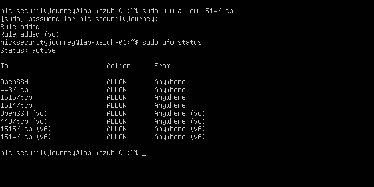
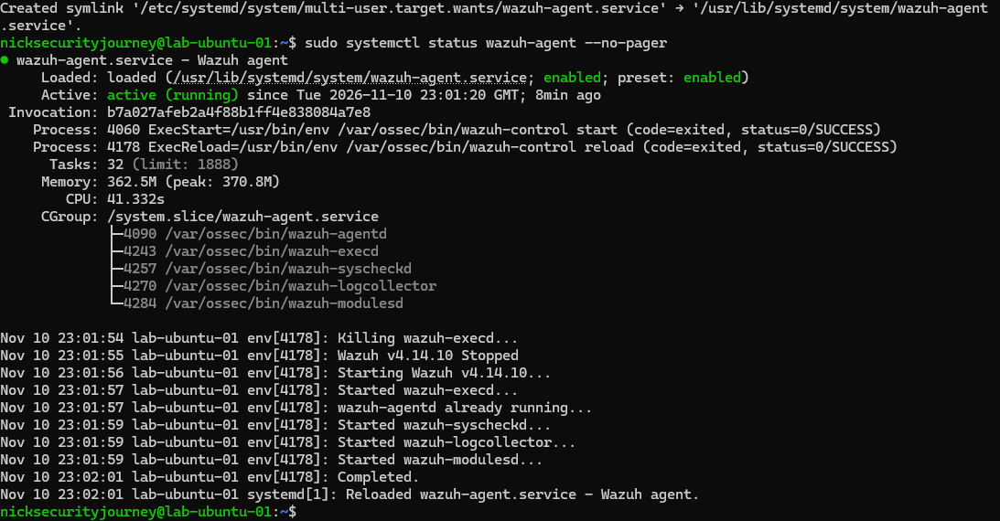
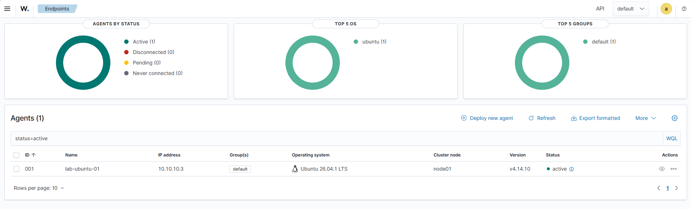

# Session 03: Connecting the first Wazuh agent

**Date:** 2026-11-10  |  **Phase:** 2 – Monitoring  |  **Time spent:** One evening, roughly 21:15–23:15

## Goal

Finish the Wazuh server's firewall, get back into the dashboard, and connect `lab-ubuntu-01` to Wazuh as a monitored agent.

## Setup

| Item | Detail |
| --- | --- |
| Wazuh server | `lab-wazuh-01`, `10.10.10.10`, Wazuh 4.14.10 |
| Monitored machine | `lab-ubuntu-01`, `10.10.10.3`, Ubuntu Server 26.04.1 LTS |
| Agent | Wazuh agent 4.14.10 (DEB package, amd64) |
| Remote access | SSH from PowerShell on my PC, through LabNet port forwards on `127.0.0.1` |

LabNet port forwards after this session (all listening on my PC only):

| Name | Host port | Goes to | Used for |
| --- | --- | --- | --- |
| wazuh-dashboard | 127.0.0.1:8443 | 10.10.10.10:443 | Wazuh dashboard in my browser |
| ssh-wazuh | 127.0.0.1:2222 | 10.10.10.10:22 | SSH into `lab-wazuh-01` |
| ssh-ubuntu | 127.0.0.1:2223 | 10.10.10.3:22 | SSH into `lab-ubuntu-01` |

## Steps

1. **Added the missing firewall rule** on `lab-wazuh-01` for agent log traffic (port 1514), which I'd spotted was missing while reviewing session 02. The firewall now allows SSH, 443, 1514 and 1515.

   ```bash
   sudo ufw allow 1514/tcp
   sudo ufw status
   ```

   

2. **Got the dashboard working again.** It was unreachable from my browser (see Problems & fixes). I re-added the port forward rule from PowerShell and confirmed it was listed:

   ```powershell
   & "C:\Program Files\Oracle\VirtualBox\VBoxManage.exe" natnetwork modify --netname LabNet --port-forward-4 "wazuh-dashboard:tcp:[127.0.0.1]:8443:[10.10.10.10]:443"
   & "C:\Program Files\Oracle\VirtualBox\VBoxManage.exe" natnetwork list
   ```

3. **Set up SSH access to both VMs from PowerShell.** The VirtualBox console window doesn't support copy and paste, so I added port forwards for SSH and connected from PowerShell instead. This made it possible to paste long commands in, and copy output back out.

   ```powershell
   & "C:\Program Files\Oracle\VirtualBox\VBoxManage.exe" natnetwork modify --netname LabNet --port-forward-4 "ssh-wazuh:tcp:[127.0.0.1]:2222:[10.10.10.10]:22"
   & "C:\Program Files\Oracle\VirtualBox\VBoxManage.exe" natnetwork modify --netname LabNet --port-forward-4 "ssh-ubuntu:tcp:[127.0.0.1]:2223:[10.10.10.3]:22"

   ssh -p 2222 nicksecurityjourney@localhost   # lab-wazuh-01
   ssh -p 2223 nicksecurityjourney@localhost   # lab-ubuntu-01
   ```

   Both VMs need to be running for this to work.

4. **Logged in to the Wazuh dashboard** at `https://localhost:8443` as `admin`.
5. **Generated the agent install commands** in the dashboard: Agents management, Summary, Deploy new agent, with these settings:

   | Setting | Value |
   | --- | --- |
   | Package | Linux, DEB, amd64 |
   | Server address | `10.10.10.10` |
   | Agent name | `lab-ubuntu-01` |

6. **Installed and started the agent on `lab-ubuntu-01`** by pasting the dashboard's commands into the SSH session, then checked it:

   ```bash
   sudo systemctl status wazuh-agent --no-pager
   ```

   The agent showed `active (running)`, version 4.14.10, and `enabled` so it starts on every boot.

   

7. **Confirmed the server could see the agent.** In the dashboard, `lab-ubuntu-01` was listed as agent `001`, IP `10.10.10.3`, Ubuntu 26.04.1 LTS, version v4.14.10, status **active**.

   

   Wazuh 4.14 doesn't officially list Ubuntu 26.04 as supported yet, but the agent installed and connected without problems.

## Problems & fixes

| Problem | Cause | Fix |
| --- | --- | --- |
| Browser said "can't reach this page" for the dashboard | First, I wasn't sure which VM needed to be on: the dashboard runs on `lab-wazuh-01`, so that one has to be running | Started `lab-wazuh-01` and waited a few minutes for Wazuh to start |
| Dashboard still unreachable with `lab-wazuh-01` running | `VBoxManage natnetwork list` showed LabNet but no port forward rules, so there was no route from my PC to the dashboard. The rule from session 02 hadn't been saved | Re-added the rule with `VBoxManage natnetwork modify` and checked it was listed; the dashboard then loaded |
| Needed the dashboard admin password | The password is printed once at the end of the Wazuh install | Retrieved it from `wazuh-install-files.tar`, which the installer leaves in the home folder |
| Couldn't copy the password out of the VM window | The VirtualBox console doesn't support copy and paste | Added SSH port forwards and connected from PowerShell, where copy and paste works |

## What I learned

- Checking the actual configuration (`natnetwork list`) found the cause quickly instead of guessing: the rule I thought existed wasn't there.
- Port forwards on `127.0.0.1` let me reach services inside the lab from my own PC without exposing them to anything else on my home network.
- Real admins rarely use a server's own screen; they SSH in. Doing the same made long commands much easier and less error-prone.
- An agent is a small program on the monitored machine that sends its logs to the SIEM. The dashboard shows whether each agent is active, disconnected or has never connected.

## Next steps

Part E: trigger test alerts on `lab-ubuntu-01` (failed SSH logins, failed sudo, creating a new user account) and investigate them in the Wazuh dashboard.
